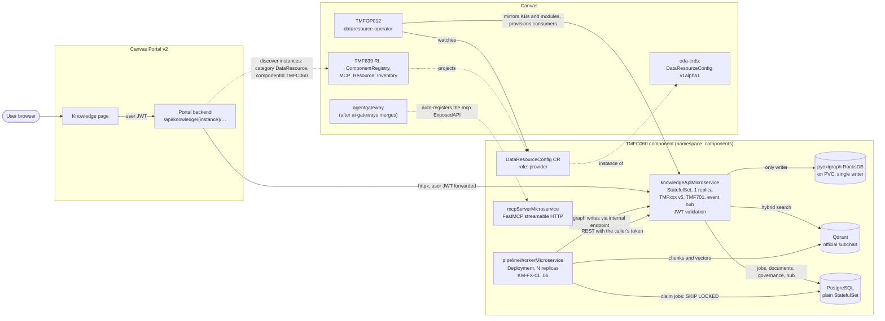
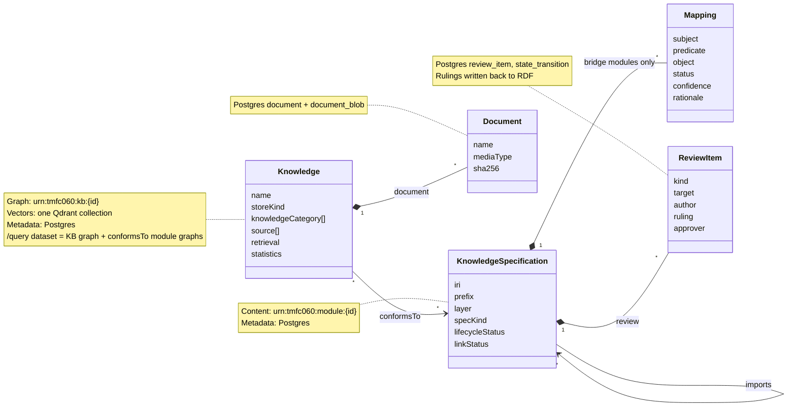
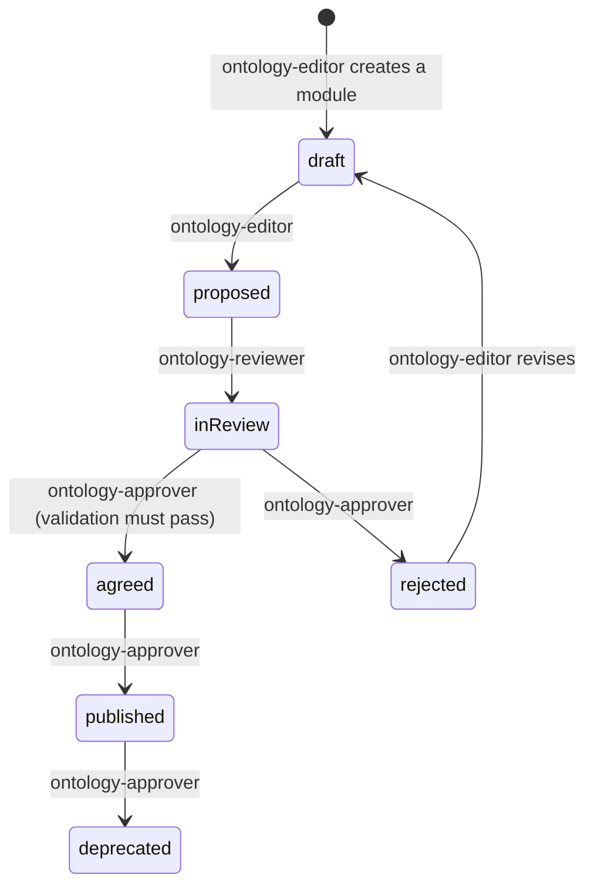
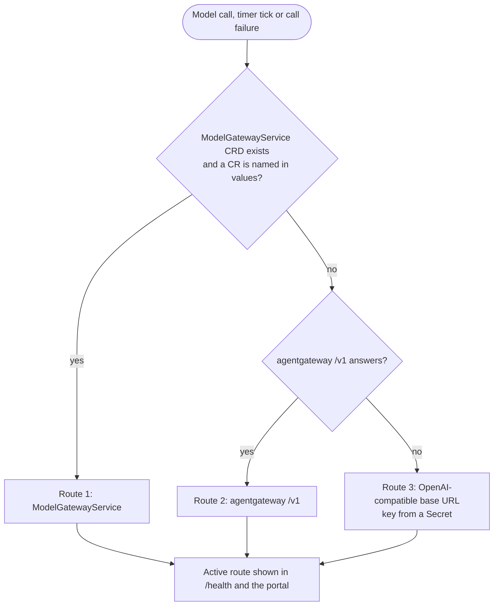
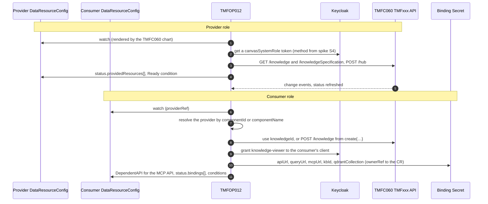

# Knowledge Management design

This document describes the design of the TMFC060 Knowledge Management reference component and the Canvas capabilities that support it. It is part of the [overall ODA Canvas design](Canvas-design.md) and extends the [AI-Native Canvas design](AI-Native-Canvas-design.md).

## Overview

The Canvas Portal v2 has an **AI → Knowledge** page with two sections, "Knowledge-Base" and "Federated Ontology". Before this work nothing in ODA served either one:

* **TMFC060 Knowledge Management** has an inception form and a draft specification with a placeholder `TMFxxx` v5 API. The API has two resources, `knowledge` and `knowledgeSpecification`.
* The **FTO ontology federation** and the **c-kg** instance graph are prototypes. FTO is a read-only MCP server over stdio; c-kg is a writable, MCP-only instance graph.
* No Canvas repository has RAG, vector or embedding code. `DataResourceConfig` exists only as a Proposed ADR. TMF639 Resource Inventory projects only the `ODAComponent` and `API` categories, and agentgateway MCP registration is manual.

The design answers three questions:

1. How does an ODA Component manage **hybrid knowledge-bases**, an RDF instance graph linked to a document and vector store (graph-RAG)?
2. How is a **federated ontology** governed, with modules contributed by many parties and a propose → review → rule workflow?
3. How does the Canvas make knowledge a **platform capability**: discoverable in Resource Inventory, bindable by other components, and reachable by agents over MCP?

The reference implementation is a new Python service. It reuses FTO's module, bridge and layer model and the c-kg tool designs, but forks neither.

## Architecture

Solid arrows are calls or writes. Dotted arrows are discovery, watch or registration.

### Component building blocks

The component lives in `source/components/TMFC060-KnowledgeManagement/`, one folder per microservice, with its Helm chart in `chart/`. It is not part of the `canvas-oda` umbrella chart.

| Building block | Kind | Responsibility |
|---|---|---|
| `knowledgeApiMicroservice` | StatefulSet, 1 replica | Serves the TMFxxx Knowledge Management v5 API, TMF701 processes and the event hub. Validates JWTs and roles. The only process that opens the graph store |
| pyoxigraph RocksDB | PVC (ReadWriteOnce) | The RDF store: one named graph per ontology module and per knowledge-base, plus a governance graph |
| `pipelineWorkerMicroservice` | Deployment, N replicas | Runs the KM-FX-01 to 06 ingestion steps as jobs claimed from PostgreSQL |
| `mcpServerMicroservice` | Deployment | A FastMCP streamable-HTTP server that wraps the REST API with the caller's token |
| Qdrant | Official Helm subchart | One collection per knowledge-base, with dense and sparse (BM25) vectors |
| PostgreSQL | Plain StatefulSet on the official `postgres` image | Jobs, document metadata and blobs, governance state and hub subscriptions |
| `DataResourceConfig` (provider) | Custom resource | Declares the component's vector and graph stores to the Canvas |

The Component CR is `oda.tmforum.org/v1`. It exposes `knowledgemanagement` (openapi, TMFxxx), `processflow` (TMF701 Process Management v5) and `knowledgemcp` (mcp), the way the reference ProductCatalog exposes a separate `mcp` API. It carries the `oda.tmforum.org/componentId: TMFC060` label for discovery.

### Single-writer rationale

pyoxigraph's RocksDB store allows **one writer process**. Only the API pod opens it. The workers never open the store: they write graphs through an internal, cluster-only endpoint on the API, authenticated by a service token.

This one-writer limit is the reason for the split between the API and the workers. It is also the reason the API runs as a single-replica StatefulSet with a ReadWriteOnce PVC. Documents are stored in PostgreSQL rather than on the PVC so that N worker replicas can read them.

## Data model

The API is specified in [`TMFxxx-KnowledgeManagement-v5.0.0.oas.yaml`](source/components/TMFC060-KnowledgeManagement/knowledgeApiMicroservice/api/TMFxxx-KnowledgeManagement-v5.0.0.oas.yaml) (OpenAPI 3.0.1). It follows TMF630 v5 conventions: `@type`/`@baseType`/`href`, `fields`/`offset`/`limit`, a `/hub` for subscriptions, and four events per resource (Create, AttributeValueChange, StateChange, Delete). Errors use the TMF630 `Error` extended with the RFC 7807 members (`type`, `title`, `detail`, `instance`), served as `application/json` or `application/problem+json`.

### `knowledge` (a knowledge-base)

| Field | Meaning |
|---|---|
| `name`, `description`, `version` | Standard identity |
| `lifecycleStatus` | The same governed lifecycle as ontology modules (`draft` … `deprecated`), see [Governance workflow](#governance-workflow). A knowledge-base starts as `draft`, can be read in every state, and its content can be changed in every state except `deprecated` |
| `knowledgeCategory[]` | know-what, know-why, know-how or know-who |
| `storeKind` | graph, vector or hybrid |
| `conformsTo[]` | KnowledgeSpecificationRefs: the ontology modules that type the KB |
| `source[]` | upload, tmf639, tmf638, tmf642, tmf628, tmf921 or remote |
| `retrieval` | `topK`, `scoreThreshold`, `hybrid` |
| `statistics` | Triple, document and chunk counts |
| `relatedParty[]`, `validFor` | Ownership and validity |

Sub-resources:

* `/knowledge/{id}/graph`: GET, PUT, POST and DELETE in Turtle or JSON-LD, in Graph Store Protocol style.
* `/knowledge/{id}/query`: read-only SPARQL with a timeout and a row cap. `SERVICE` is allowed only to allowlisted peers.
* `/knowledge/{id}/search`: hybrid dense and sparse search, filterable by ontology IRI.
* `/knowledge/{id}/recommend`: ranked recommendations (KM-FX-06).
* `/knowledge/{id}/document`: multipart upload, list, get and delete.
* `/knowledge/{id}/ingest`: starts a TMF701 v5 `process` (one `task` per KM-FX function) and returns a reference to it.

### `knowledgeSpecification` (an ontology module)

The resource is modelled on FTO's `modules.json` and `fto.ttl`. It governs ontology modules, which resolves the specification's open decision D-01 as "yes".

| Field | Meaning |
|---|---|
| `iri`, `prefix`, `version` | Module identity |
| `layer` | Foundational, Telecom or Implementation |
| `specKind` | ontology, vocabulary, shapes, bridge or remote |
| `owner`, `imports[]` | Owning party and `owl:imports` |
| `source` | upload, git (url, ref, path, Secret ref), mount, componentContribution or remoteEndpoint |
| `lifecycleStatus` | See [Governance workflow](#governance-workflow) |
| `linkStatus` | provisional or confirmed (FTO `fto:linkStatus`) |

Sub-resources:

* `/knowledgeSpecification/{id}/content`: the module in Turtle.
* `/knowledgeSpecification/{id}/mapping`: bridge statements, each with subject, predicate, object, status (agreed or proposed), confidence (high, medium or low) and rationale. This is FTO's reified `bridge:mapping`.
* `/knowledgeSpecification/{id}/review`: proposals, review comments, and rulings with approver and date.
* `/knowledgeSpecification/{id}/validation`: the structural check results and the SHACL report.
* `/knowledgeTerm?iri=|q=`: describe, search and layer-chain lookups, equivalent to the FTO MCP tools `fto_describe`, `fto_search` and `fto_layer_of`. It is a separate path so that it cannot collide with a module id under `/knowledgeSpecification/{id}`.

### Storage

* **Graph store (pyoxigraph):** one named graph per module, `urn:tmfc060:module:{id}`, and one per knowledge-base, `urn:tmfc060:kb:{id}`, plus a governance graph. A KB query runs over the union of the KB graph and the module graphs the KB `conformsTo`, the way FTO's MCP server unions its module graphs.
* **Vector store (Qdrant):** one collection per knowledge-base. Each point has a dense vector from the resolved embedding model and a sparse BM25 vector computed by the service. Payloads carry the ontology IRIs a chunk mentions, so that search can filter by IRI.
* **State store (PostgreSQL):** the job table behind TMF701 processes, document metadata and blobs, review items and state transitions, and hub subscriptions. The schema is managed with Alembic migrations.

## Governance workflow

Ontology modules and mappings follow one lifecycle. Each transition is allowed to one component role.

| Transition | Role | Condition |
|---|---|---|
| create → `draft` | `ontology-editor` | |
| `draft` → `proposed` | `ontology-editor` | |
| `proposed` → `inReview` | `ontology-reviewer` | |
| `inReview` → `agreed` | `ontology-approver` | Validation must pass |
| `inReview` → `rejected` | `ontology-approver` | |
| `rejected` → `draft` | `ontology-editor` | The review history is kept |
| `agreed` → `published` | `ontology-approver` | |
| `published` → `deprecated` | `ontology-approver` | |

* **Review comments.** An `ontology-reviewer` may comment while an item is `proposed` or `inReview`. Comments close when the item is ruled `agreed` or `rejected`.
* **Rulings are recorded twice.** Every transition is stored in PostgreSQL (`review_item`, `state_transition`) with author, approver and date. A ruling is also written back to RDF so that the module content stays self-describing.
* **FTO compatibility.** FTO itself knows only `agreed`/`proposed` for bridges and `provisional`/`confirmed` for `fto:linkStatus`. Both are kept as fields. A mapping's `bridge:status` is derived from the lifecycle:

  | Lifecycle state | `bridge:status` written to RDF |
  |---|---|
  | `draft`, `proposed`, `inReview`, `rejected` | `proposed` |
  | `agreed`, `published` | `agreed` |
  | `deprecated` | keeps the last value and adds `owl:deprecated true` |

  `linkStatus` is set by the `ontology-approver` when ruling. It is not derived from the lifecycle.
* **Validation.** The validation sub-resource ports the five FTO structural checks: every file parses; the folder matches the layer annotation; layers are monotonic; parents resolve; the catalog is intact. It adds pyshacl validation against the module's shapes.
* **Machine proposals.** Conflict resolutions suggested by the ingestion pipeline (KM-FX-04), and `propose_mapping` calls from MCP clients, always enter the workflow as `proposed` items. They are never applied directly.

* **Knowledge-bases** follow the same lifecycle (confirmed on 2026-11-22): `knowledge-editor` proposes and revises, `ontology-reviewer` moves to review, `ontology-approver` rules, publishes and deprecates.

## Federation

Federation works at two levels: modules and queries.

* **Module federation.** Modules are organised in FTO's three layers: Foundational, Telecom and Implementation. `owl:imports` resolves through a catalog with the semantics of FTO's `catalog.json`. Module content is loaded from an upload, a git URL (with a credential Secret), or a mounted Secret or PVC.
* **Component-contributed modules.** Another ODA Component can contribute its own ontology module (source `componentContribution`). It enters the same governance workflow as any other module.
* **Query federation.** A federation peer is a `knowledgeSpecification` with `specKind: remote`. A peer is either a remote SPARQL endpoint or another TMFC060 instance, found by IRI. This keeps federation inside the two API resources, without a third resource type. Queries reach peers through SPARQL `SERVICE` clauses, and only allowlisted endpoints are accepted. Remote calls have a timeout, and results are cached.

Spike S3 ([#20](https://github.com/hw-irc-sni/oda-canvas/issues/20), pyoxigraph 0.5.13) found that pyoxigraph executes `SERVICE` natively, but offers no way to allowlist endpoints and no query timeout: a query to an unreachable peer hangs, even with `SILENT`. The design is therefore:

* **Pre-check.** Before a query runs, the service parses it with rdflib and collects every `SERVICE` target. A target that is not the endpoint of a published `remote` module, a variable target, or a query that cannot be parsed is rejected with `403 SERVICE_NOT_ALLOWED`.
* **Killable worker.** Each `/query` runs in a short-lived worker process that opens the store with `Store.read_only` (about 22 ms, and it sees the latest writes) and uses the native `SERVICE`. It is killed at the timeout, which answers `504`. The API process remains the only writer.
* **Egress policy.** As defence in depth, the chart can limit egress to the peer endpoints with a NetworkPolicy.

## Ingestion pipeline

The `pipelineWorkerMicroservice` implements the six inception-form functions as job steps of a TMF701 process.

```mermaid
flowchart LR
  up["Document upload<br/>/knowledge/{id}/document"] --> ing
  ev["TMF639/638/642/628/921 events<br/>TMFOP006, or direct hub (spike S5)"] --> lis["Listener: event → KBs whose<br/>source[] includes that API"]
  lis --> ing["POST /knowledge/{id}/ingest"]
  ing --> proc["TMF701 process<br/>one task per KM-FX step"]
  proc --> jobs[("Postgres job table")]
  jobs -->|"claim: SELECT … FOR UPDATE SKIP LOCKED"| fx1
  subgraph worker["pipelineWorkerMicroservice, N replicas"]
    fx1["KM-FX-01 Data Processing<br/>parse, clean, chunk"]
    fx2["KM-FX-02 Information Extraction<br/>ontology-constrained LLM"]
    fx3["KM-FX-03 Knowledge Generation<br/>entity linking, PROV-O"]
    fx4["KM-FX-04 Knowledge Fusion<br/>SHACL, rules, OWL-RL"]
    fx5["KM-FX-05 Knowledge Storage"]
    fx6["KM-FX-06 Knowledge Recommendation<br/>ranking signals"]
    fx1 -->|"text chunks: LLM extraction"| fx2
    fx1 -->|"RDF input: no chunking, lifted directly"| fx2
    fx2 --> fx3 --> fx4 --> fx5 --> fx6
  end
  fx4 -.->|"conflict resolutions as proposed review items"| rev["Governance review queue"]
  fx5 -->|"triples via internal endpoint"| api["knowledgeApiMicroservice<br/>RocksDB"]
  fx5 -->|"dense + sparse vectors, IRI payloads"| qd[("Qdrant collection per KB")]
```

1. **KM-FX-01 Data Processing** parses PDF, Markdown, HTML, Turtle and JSON-LD, plus TMF payloads, then cleans and chunks the text.
2. **KM-FX-02 Information Extraction** uses an LLM to extract entities and relations, constrained by the ontology the KB conforms to. RDF payloads, such as TMF921 intent expressions, are lifted directly.
3. **KM-FX-03 Knowledge Generation** links to existing entities by IRI or label match and records provenance in PROV-O.
4. **KM-FX-04 Knowledge Fusion** detects conflicts with SHACL and rule checks and applies RDFS/OWL-RL reasoning (owlrl). LLM-suggested resolutions become *proposed* review items.
5. **KM-FX-05 Knowledge Storage** writes triples through the API's internal endpoint, upserts chunks and vectors into Qdrant, and links chunks to the graph entities they mention.
6. **KM-FX-06 Knowledge Recommendation** maintains ranking signals: success rate, applicability, and usage feedback recorded on `/recommend` calls.

Inventory, assurance and intent events (TMF639, TMF638, TMF642, TMF628 and TMF921) are declared as `eventNotification.subscribedEvents` in the Component CR and delivered by the Event Management operator (TMFOP006). Spike S5 ([#21](https://github.com/hw-irc-sni/oda-canvas/issues/21)) found that TMFOP006 is not implemented: the Component operator turns `subscribedEvents` into `SubscribedNotification` resources, but nothing acts on them. So TMFC060 subscribes itself:
* it declares the source APIs as optional dependent APIs, with the providers' exact specification URLs (TMFOP005 matches on them);
* it reads each resolved URL from the canvas-info service (TMF638), as the reference components do;
* it registers a hub on each provider for the knowledge-bases that use that source.

The Component keeps `subscribedEvents`, so that a future TMFOP006 can take over.

## Model resolution

The extraction and embedding steps need an LLM and an embedding model. The service resolves them through a chain. The chain is re-evaluated on a timer and whenever a model call fails.

1. **ModelGatewayService**, if its CRD exists and a CR is named in the chart values.
2. **agentgateway** `/v1`, if it answers.
3. An **OpenAI-compatible base URL**, with its API key in a Secret.

The active route is reported in `/health` and shown in the portal. Route 1 needs the component to read Kubernetes resources, which ODA Components don't normally do. The chart therefore adds a Role and RoleBinding (`get`/`list` on `modelgatewayservices`, `get` on the CRD) behind a values flag.

## Security

### Roles

The component declares its roles as `securityFunction.componentRole` in the Component CR. The Identity Config operator (TMFOP003) creates them in Keycloak.

| Role | Allows |
|---|---|
| `knowledge-viewer` | Read knowledge-bases, search, query and recommend |
| `knowledge-editor` | Knowledge-base writes, document upload and ingestion |
| `ontology-editor` | Create and propose modules and mappings; revise rejected items |
| `ontology-reviewer` | Move proposals to review and comment on them |
| `ontology-approver` | Rule items agreed or rejected, publish and deprecate |
| `canvasSystemRole` | Used by Canvas operators and provisioning, for example TMFOP012 |

### Role matrix

Every operation of the API lists the roles allowed to call it in an `x-required-roles` extension; any one of them is enough. The matrix:

| Operations | Roles |
|---|---|
| Read knowledge-bases: list, get, graph GET, query, search, recommend and its feedback, documents, `/hub` | `knowledge-viewer`, `knowledge-editor`, `canvasSystemRole` |
| Change knowledge-bases: create, patch, delete, graph PUT/POST/DELETE, document upload and delete, ingest | `knowledge-editor`, `canvasSystemRole` |
| Read the ontology: modules, content, mappings, review history, validation report, `/knowledgeTerm` | all five component roles and `canvasSystemRole` |
| Author: create a module, change its fields or content, create or change mappings | `ontology-editor` |
| Review: comment, run validation | `ontology-reviewer` (editors and approvers may also run validation) |
| Rule: rulings | `ontology-approver` |
| Lifecycle transitions | per transition, as in [Governance workflow](#governance-workflow); machine-readable in the `x-lifecycle` extensions of `KnowledgeSpecification` and `Knowledge`, and the `x-review-kinds` extension of `ReviewItem`. For knowledge-bases, `knowledge-editor` takes the proposer's place (draft → proposed, rejected → draft) |
| Delete a module or mapping | `ontology-editor` (draft or rejected only), `ontology-approver` (any state) |

### Enforcement

Roles are enforced in two places:

* **In the component.** `auth.py` validates the JWT against the Canvas Keycloak JWKS and reads the component client roles from `resource_access`. Any call without the required role gets a **403**, whatever its origin.
* **In the portal.** The portal backend forwards the **user's own bearer token** to the component. It returns a `capabilities` object computed from the user's component roles, and the frontend hides actions those capabilities don't allow. The portal never echoes an upstream 401: it passes a 403 through and maps a 401, a 5xx or a timeout to a 502. Uploads stream through with a size cap (413 above it).

Whether the portal's access token carries each TMFC060 instance's client roles is an unverified mechanic (spike S1). If it doesn't, the fallback is an audience/role mapper on the `canvas-portal` client, or Keycloak token exchange per instance in the backend.

The internal graph-write endpoint is reachable only inside the cluster and is authenticated by a service token. The MCP server calls the REST API with the token of its caller, so MCP clients get exactly the rights of their role.

## Canvas integration

The Canvas gains four capabilities so that knowledge becomes a platform service rather than a component detail.

1. **`DataResourceConfig` CRD** (`oda.tmforum.org/v1alpha1`, namespaced, standalone), as refined by [ADR-010](https://github.com/hw-irc-sni/ai-canvas-architecture/blob/adr-tmfc060-knowledge/decision-log/ADR-010-data-resource-config-refinement.md). It **extends the existing draft CRD** of the AI-Native Canvas architecture, which was written for Databricks, in a backward-compatible way, so the two uses share one resource. It links to its component by the `oda.tmforum.org/componentName` label or an ownerRef, so the Component CRD doesn't change. The additions:
   * `spec.provider` gains `odaComponent` next to `databricks`: the data resource is served by an ODA Component.
   * `spec.role`: `consumer` (default) or `provider`.
   * `dependentDataResources[]` (consumer) items gain `type` (`vectorStore`, `knowledgeGraph`, `dataProduct` or `cache`, from the Component v2alpha1 proposal), `required`, `retrieval{topK, scoreThreshold, hybrid}`, `access` (`read` or `readWrite`) and `providerRef{componentId | componentName, knowledgeId | create{…}}`. The existing `dataProductType`, `catalogRef` and `physicalStorage` stay.
   * `providedDataResources[]` (provider) declares the stores a component serves: name, type, engine and the ExposedAPIs that serve them.
   * `status` keeps `phase` and adds `conditions`, `providedResources[]` and `bindings[]`.
   * The Databricks-only fields (`workspace`, `accessType`) become conditionally required through CEL validation rules. An operator writes status only on CRs whose `spec.provider` it owns.

   That a standalone CRD needs no webhook conversion change is to be confirmed (spike S6). The fallback is conversion stubs.
2. **TMFOP012 Data Resource Management operator** (`dataresource-operator`, kopf). It handles `provider: odaComponent`.
   * **Provider role:** mirrors the component's knowledge-bases and modules into the CR status, by polling the API and listening on its hub.
   * **Consumer role:** resolves the provider and ensures the knowledge-base exists, using canvasSystemRole credentials. It grants the consumer component's identity client the TMFC060 role (`knowledge-viewer`, plus `knowledge-editor` for `access: readWrite`). It then writes a **binding Secret** (`apiUrl`, `queryUrl`, `mcpUrl`, `kbId`, `providerComponent` and, for reference, `qdrantCollection`) and a **DependentAPI** for the MCP API, both owned by the CR. Deleting the CR removes both and revokes the role; the knowledge-base is kept.

   Consumers access data only through the API or MCP (ADR-007 Pattern A). They never receive Qdrant or RocksDB credentials. How an operator obtains a canvasSystemRole token is an unverified mechanic (spike S4); the fallback is Keycloak client credentials for an operator client.
3. **Resource Inventory** ([ADR-011](https://github.com/hw-irc-sni/ai-canvas-architecture/blob/adr-tmfc060-knowledge/decision-log/ADR-011-data-resources-in-resource-inventory.md)). TMF639 gets a `DataResource` category projected from `DataResourceConfig` at two levels. **Store** entries come from `providedDataResources[]` and carry `type` and `engine`. **Content** entries are the knowledge-bases and ontology modules mirrored in the CR status; they carry `kind`, `storeKind`, `layer` and `lifecycleStatus`. Entries are `providedBy` the ODAComponent (inverse `provides`), and content is `isPartOf` its stores (inverse `contains`). A bound consumer component `dependsOn` its knowledge-base. ODAComponent gains a `componentId` characteristic from `componentMetadata.id`. The same projection is mirrored in ComponentRegistry and in the MCP_Resource_Inventory category filter and prompts. The portal discovers TMFC060 instances this way, with a configured-URL override.
4. **agentgateway MCP auto-registration.** An operator handler watches `ExposedAPI` resources with `apiType: mcp`. It patches only its own entries, prefixed `oda-<namespace>-<name>`, in the agentgateway `mcp.targets` configuration. The portal's MCP target editor must preserve these operator-owned entries. This work waits until the `ai-gateways` branch merges.

## Licensing

**The image and the chart ship no ontology content.** Modules come only from an upload, a git URL or a mounted Secret or PVC. The chart's `ontologySources[]` value selects the source. A separate demo values file points at a private FTO repository through a git credential Secret. No TIO or irc-core content is packaged.

## Open items

These standards-side items are parked. They don't block the reference implementation.

* **D-02:** the SID Knowledge ABE.
* **D-03:** a real API number to replace `TMFxxx`.
* **D-04:** ownership of functional framework functions 1451 and 1468–1470 versus SMIC.
* **D-05:** functional framework functions 1001 and 1002.
* **D-07:** the Capability Catalog boundary. Know-who sources are treated as an ingestion source for now.
* **D-09:** the inventory index.
* **Rule fixes:** R-024, R-028 and R-030 in the inception form, and the R-030 parent-and-children listing in the specification YAML.
* **Licensing:** the ownership ruling on TIO and irc-core.

These mechanics are unverified. Each is checked by a short spike at the start of the phase that depends on it, and each has a fallback, described in the sections above:

| Spike | Question | Section |
|---|---|---|
| S1 | Does the portal access token carry the component client roles? | [Security](#security) |
| S2 | Can the portal pod reach the ExposedAPI URL from Resource Inventory? If not, the in-cluster Service URL is built from the ExposedAPI implementation | [Canvas integration](#canvas-integration) |
| S3 | Does pyoxigraph execute SPARQL `SERVICE`, with an allowlist? **Done (#20):** yes natively, no allowlist or timeout; rdflib pre-check plus killable read-only workers | [Federation](#federation) |
| S4 | How does an operator obtain a canvasSystemRole token? | [Canvas integration](#canvas-integration) |
| S5 | What does TMFOP006 support for `subscribedEvents` delivery? **Done (#21):** nothing (not implemented); TMFC060 registers hubs on the providers, with URLs from canvas-info | [Ingestion pipeline](#ingestion-pipeline) |
| S6 | Does a standalone CRD need a webhook conversion change? | [Canvas integration](#canvas-integration) |

## Related Documentation

* [Canvas Design Overview](Canvas-design.md)
* [AI-Native Canvas Design](AI-Native-Canvas-design.md)
* [Authentication Design](Authentication-design.md)
* [Event-based Integration Design](Event-based-integration-design.md)
* [UC018 Knowledge and Ontology Management](usecase-library/UC018-Knowledge-and-Ontology-Management.md)
* [AI Canvas architecture decision log](https://github.com/hw-irc-sni/ai-canvas-architecture/tree/main/decision-log): ADR-005 and ADR-007 (data resources), ADR-003 (Resource Inventory)
* Proposed ADRs for this work ([PR](https://github.com/hw-irc-sni/ai-canvas-architecture/pull/1)): [ADR-009](https://github.com/hw-irc-sni/ai-canvas-architecture/blob/adr-tmfc060-knowledge/decision-log/ADR-009-knowledge-and-ontology-provider.md) TMFC060 as knowledge and ontology provider, [ADR-010](https://github.com/hw-irc-sni/ai-canvas-architecture/blob/adr-tmfc060-knowledge/decision-log/ADR-010-data-resource-config-refinement.md) DataResourceConfig refinement, [ADR-011](https://github.com/hw-irc-sni/ai-canvas-architecture/blob/adr-tmfc060-knowledge/decision-log/ADR-011-data-resources-in-resource-inventory.md) data resources in Resource Inventory
* [Delivery tracking issue](https://github.com/hw-irc-sni/oda-canvas/issues/90)
