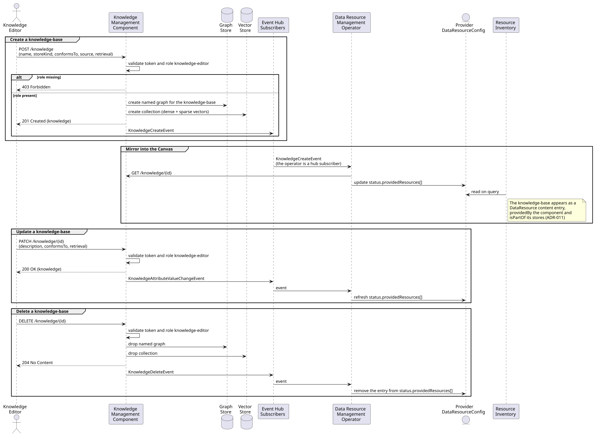
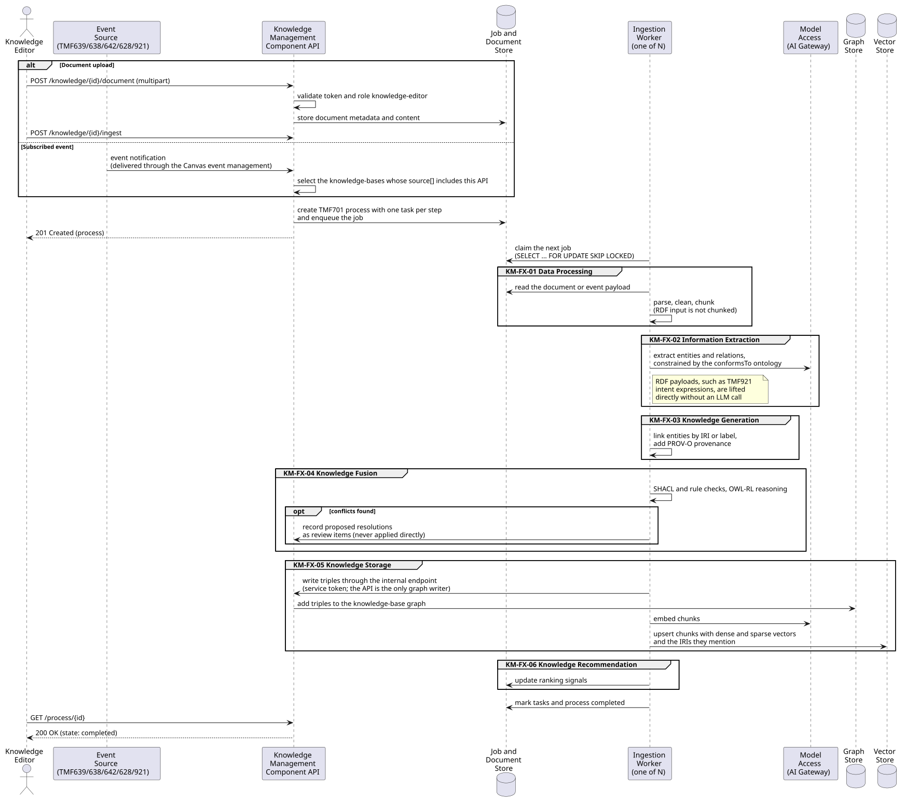
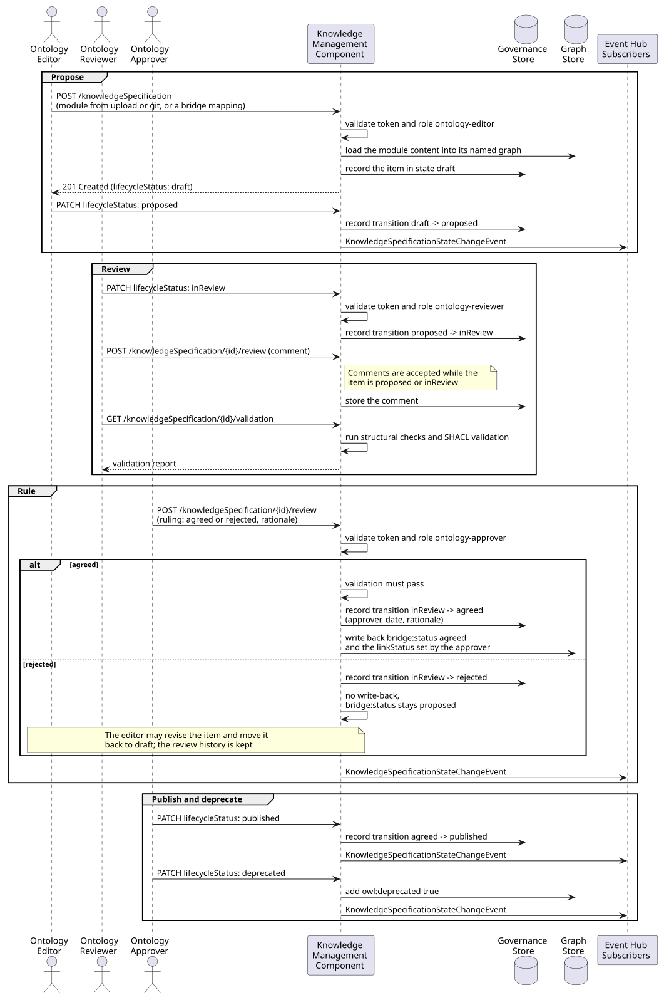
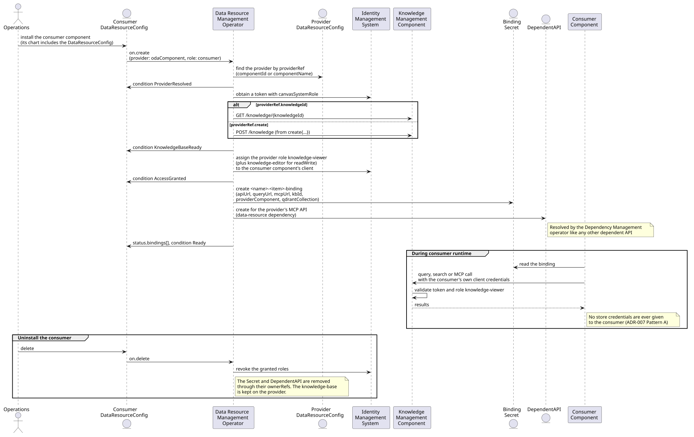
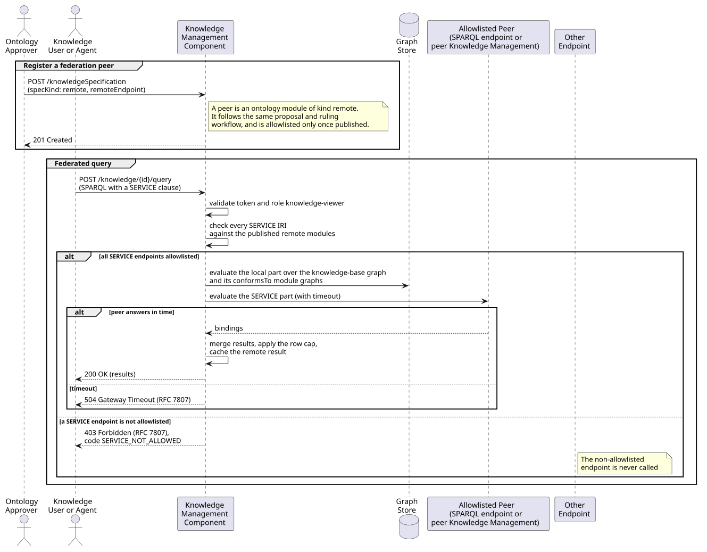

# Knowledge and Ontology Management use-case

This use-case describes how a Knowledge Management component interacts with the ODA Canvas, and how users, agents and other components use it. The component manages **knowledge-bases** (an RDF instance graph linked to a document and vector store) and a **federated ontology** of governed modules. The Canvas makes these a platform capability: the component's data resources are declared to the Canvas, published in Resource Inventory, bindable by consuming components, and reachable by agents over MCP.

The reference implementation is the TMFC060 Knowledge Management component. Its design is in [Knowledge-Management-design.md](../Knowledge-Management-design.md). The architecture decisions are ADR-009 (the knowledge and ontology provider), ADR-010 (the `DataResourceConfig` refinement) and ADR-011 (data resources in Resource Inventory) in the AI Canvas architecture decision log.

## Assumptions

- The ODA Canvas is installed with Identity Management, API Management, Dependency Management and Resource Inventory.
- The `DataResourceConfig` custom resource and the Data Resource Management operator are installed.
- The Knowledge Management component is installed as an ODA Component. It exposes a Knowledge Management API (`openapi`), a TMF701 process flow API (`openapi`) and an MCP API (`mcp`).
- Its Helm chart includes a provider `DataResourceConfig` that declares its vector store and knowledge graph.
- The component declares these component roles, which the Identity Config operator creates in the Identity Management System:

  | Role | Allows |
  |---|---|
  | `knowledge-viewer` | Read knowledge-bases, search, query and recommend |
  | `knowledge-editor` | Change knowledge-bases, upload documents and start ingestion |
  | `ontology-editor` | Create and propose ontology modules and mappings |
  | `ontology-reviewer` | Review proposals and comment on them |
  | `ontology-approver` | Rule proposals, publish and deprecate modules |

- The component authorises every call against these roles, whether it comes from the Canvas Portal, an agent over MCP, or another component.
- An LLM and an embedding model are reachable through the Canvas model access path, or through a configured OpenAI-compatible endpoint.

## Manage a knowledge-base

A knowledge editor creates, updates and deletes knowledge-bases through the Knowledge Management API. The component creates or drops the knowledge-base's graph and vector collection and publishes an event for each change. The Data Resource Management operator subscribes to these events. It mirrors the knowledge-bases into the status of the provider `DataResourceConfig`, so that Resource Inventory lists each one as a `DataResource`.

[plantUML code](pumlFiles/knowledge-base-lifecycle.puml)

## Ingest knowledge

Knowledge enters a knowledge-base from uploaded documents or from events of the APIs listed in the knowledge-base's sources (resource and service inventory, alarms, trouble tickets and intents). Each ingestion is a TMF701 process. Worker replicas claim its job and run the six Knowledge Management functions: data processing, information extraction, knowledge generation, knowledge fusion, knowledge storage and knowledge recommendation.

Conflicts found during fusion become *proposed* review items. They are never applied without a ruling. Workers write triples only through the component's internal endpoint, because the API is the only writer of the graph store.

[plantUML code](pumlFiles/knowledge-ingestion.puml)

## Propose, review and rule on the ontology

Ontology modules and bridge mappings follow a governed lifecycle:

`draft → proposed → inReview → agreed | rejected → published → deprecated`

A rejected item may be revised and returned to `draft`. Each transition belongs to one role. Reviewers comment while an item is `proposed` or `inReview`. An item can be ruled `agreed` only when validation passes. Every ruling is recorded with approver, date and rationale, and written back to the module's RDF as the mapping status.

[plantUML code](pumlFiles/ontology-proposal-and-ruling.puml)

## Bind a consumer to a knowledge-base

A consuming component declares the knowledge it needs in its own `DataResourceConfig` with `role: consumer`. The Data Resource Management operator then:
1. resolves the provider;
2. ensures the knowledge-base exists;
3. grants the consumer component the provider's role;
4. writes a binding Secret and a DependentAPI.

The consumer calls the provider with its own credentials. It never receives the credentials of the underlying stores. When the consumer is uninstalled, the binding is removed and the role revoked. The knowledge-base is kept.

[plantUML code](pumlFiles/data-resource-binding.puml)

## Query across federated knowledge

A remote SPARQL endpoint, or a peer Knowledge Management component, is registered as an ontology module of kind `remote`. It goes through the same proposal and ruling workflow. Queries may reach published peers through SPARQL `SERVICE` clauses, with a timeout. A query that names any other endpoint is rejected before that endpoint is called.

[plantUML code](pumlFiles/knowledge-query-federation.puml)

## Related use-cases

- [UC002 Manage Components](UC002-Manage-Components.md): the Knowledge Management component and its consumers are installed as ODA Components.
- [UC003 Configure Exposed APIs](UC003-Configure-Exposed-APIs.md): the Knowledge Management, process flow and MCP APIs are exposed through the Canvas.
- [UC005 Configure Clients and Roles](UC005-Configure-Clients-and-Roles.md): the component roles are created in the Identity Management System.
- [UC007 Configure Dependent APIs](UC007-Configure-Dependent-APIs.md): a binding creates a DependentAPI for the provider's MCP API.
- [UC008 Configure Subscribed Events](UC008-Configure-Subscribed-Events.md): inventory, alarm, trouble-ticket and intent events feed ingestion.
- [UC016 ODA Component and API Registry](UC016-ODA-Component-and-API-Registry.md): Resource Inventory lists the data resources next to components and APIs.

## BDD features

The test scenarios for this use-case are in [feature-definition-and-test-kit](../feature-definition-and-test-kit/README.md):
- `UC018-F001`: deploying the Knowledge Management component publishes its data resources in Resource Inventory.
- `UC018-F002`: a consumer `DataResourceConfig` receives a binding Secret.
- `UC018-F003`: the component's MCP API is registered with the AI gateway.
